# Matchday Africa design language for video and social output

One look for everything Matchday Africa publishes as video or a social image: match stories,
radio videos, slideshows, the 20-second reels and the preview cards. This page is the rulebook;
the code is the single implementation of it.

| What | Where |
|---|---|
| Tokens (colours, fonts, type scale, grid, motion, music, image and copy rules) | `matchday-africa/resources/design/tokens.json` |
| PHP module every GD renderer imports | `matchday-africa/app/Design/` (`Tokens`, `Canvas`, `Scene`, `Components`, `Film`, `Motion`, `CopyRules`, `DesignCheck`) |
| Remotion reel import of the same tokens | `matchday-africa/reel/src/design.js` |
| Reference image of each component | `docs/design/<component>.png` (`php artisan design:references`) |
| Design check (contact sheet + rule report) | `php artisan design:check` |
| Sample data for the reference images | `matchday-africa/resources/design/samples.json` |

Nothing visual is hard-coded in a renderer: `tests/Feature/DesignLanguageTest.php` fails on any hex
colour, RGB triplet, literal GD colour, CSS `rgb()` literal or font file name in a renderer, and on a
renderer that does not import the design module.

## 1. Brand tokens

### Colours

| Token | Hex | Use |
|---|---|---|
| `black` | `#0A0A0A` | Backdrop of every frame; panel behind yellow text |
| `yellow` | `#FFD23F` | Hooks, chips, highlights, the banter card |
| `white` | `#FFFFFF` | Headlines and body on black; the radio caption panel |
| `grey` | `#C8C8C8` | Muted labels, sub-lines, the photo credit |
| `surface` | `#1B1B1B` | Black lifted one step for cards and rows (counts as black for contrast) |
| `red` | `#E10600` | Signal only: red cards and losses |

Team colours come from the `teams` table (`primary_color`, `secondary_color`, when both are stored as
hex), then the curated lists (`config/armies.php`, `config/slideshow.php` club and nation colours).
They are used for **bands, score blocks, flags, swatches and bars only**, never for body text.

**Contrast rules** (`tokens.contrast`, enforced by `Canvas::assertPair` when a text item is created):

| Background | Allowed text |
|---|---|
| black, surface | yellow, white, grey |
| yellow | black |
| white | black |
| red | white |
| a team colour | black or white, whichever contrasts more (WCAG ratio, `Canvas::ink`) |

Yellow text only ever sits on black; black text is what goes on yellow.

### Typography

Anton for headlines, scores and hooks; Inter (Regular, SemiBold, Bold; SIL OFL, in
`resources/fonts/`) for body, labels and captions. Sizes are pixels on the 1080x1920 canvas
(GD takes points; `Canvas::pt` converts). Text may step down to the style's minimum to fit; below
that it is cut with an ellipsis rather than leave the safe zone.

| Style | Font | Size | Min | Use |
|---|---|---|---|---|
| `hook` | Anton | 120 | 96 | Hooks, "Goal!", the banter line, radio story headlines |
| `headline` | Anton | 72 | 56 | Names, card headlines, the question |
| `score` | Anton | 160 | 120 | The score, head-to-head counts |
| `strip` | Anton | 56 | 36 | The scoreboard strip, the closing URL |
| `body` | Inter SemiBold | 40 | 32 | Lines and facts |
| `strong` | Inter Bold | 40 | 32 | Row names, fact lines |
| `caption` | Inter Bold | 52 | 40 | Radio captions read along with the voice |
| `label` | Inter Bold | 28 | 24 | Chips, minute tags, table headers |
| `credit` | Inter Regular | 20 | 18 | Photo credit |

**Sentence case everywhere.** Capitals only for the score and the minute ("63'"). Initials in a
monogram and licence codes (CC BY-SA) are not sentences.

### Logo

The MD square mark (`public/icons/icon-512.png`) top-left at x 80, y 124, 96 px, on **every frame**
(drawn by `Film` after everything else). The closing card adds a larger mark next to
`matchday.africa/…`.

## 2. Layout grid (1080x1920)

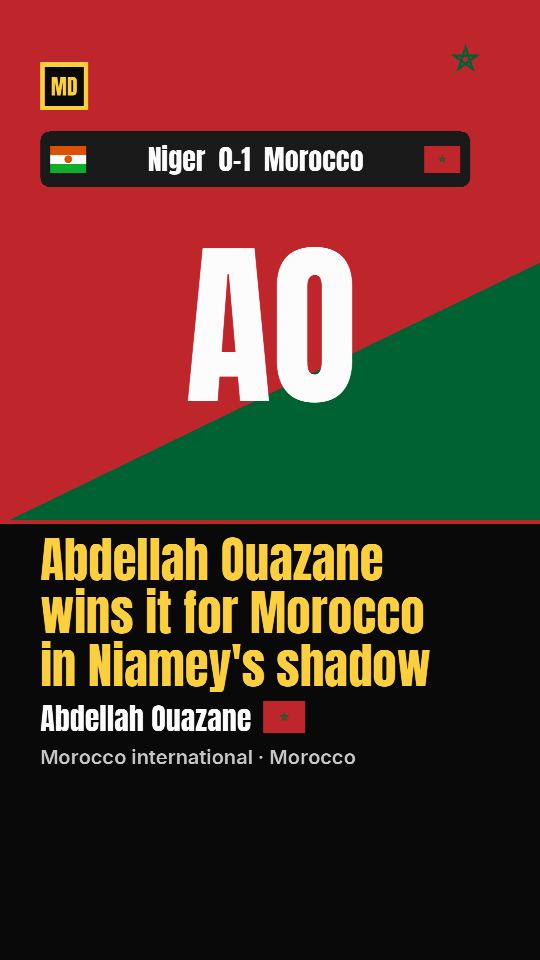

- **Safe zone:** top 250 px, bottom 380 px and right 140 px stay clear of text (TikTok, Reels and
  YouTube Shorts UI); left margin 80. Text area x 80–940, y 250–1540. Every text box and flag is
  checked when a card is laid out (`Film::check`); a box outside fails the render.
- **Fill:** each card's body is a stack of blocks stretched to the safe zone (`Scene::stack`), so
  content is centred and fills it. No frame may be more than **35%** bare backdrop inside the safe
  zone (`grid.max_empty`; measured on the pixels by the design check).
- **Fixed positions:** scoreboard strip y 262–374; chips row (label chip left, minute tag right)
  y 398–462; photo area = top 60% of the safe zone (y 250–1024); caption area y 1048–1540; photo
  credit baseline y 1532; body stack from y 486.

## 3. Components

One implementation each, in `app/Design/Components.php`; each lists its in/out motion in
`tokens.components`. Every cut leaves with the colour-band wipe of the next one (the closing card
holds).

| Component | Reference | In | Used by |
|---|---|---|---|
| `hook` — full-bleed licensed photo (or our own render: the sides' colours on a diagonal with both flags), scoreboard with both flags, hook in yellow on black, credit |  | Visible from frame 0, settles in | story, slideshow |
| `matchup` — competition, both sides as colour bands, context lines | 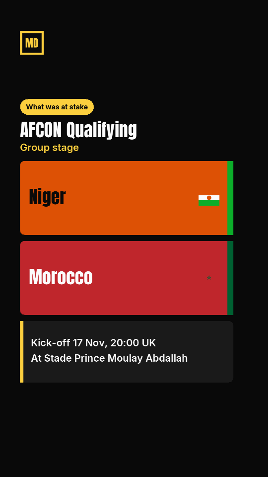 | Words rise, bands grow | story (build-up), slideshow (preview) |
| `score_block` — label, names row, two-colour score block, lines | 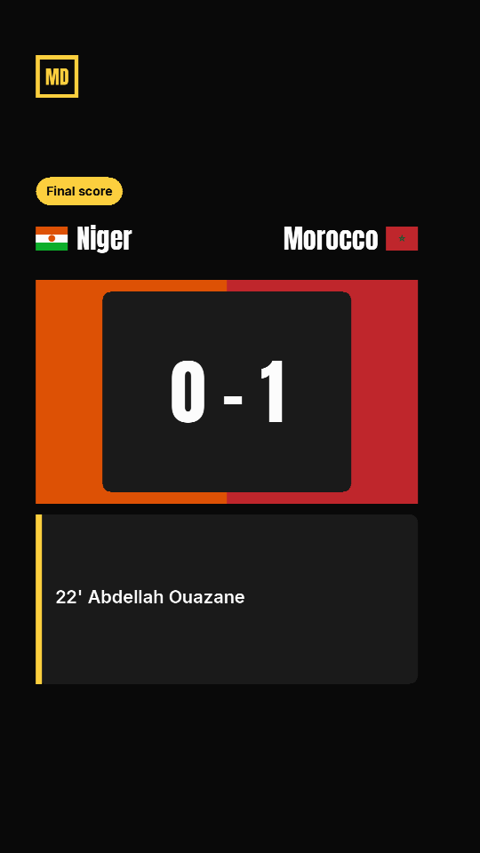 | Punch-in | story (recaps, last meeting), slideshow |
| `goal` — side chip + minute tag, "Goal!" on the side's colour, scorer, score counter ticking over | 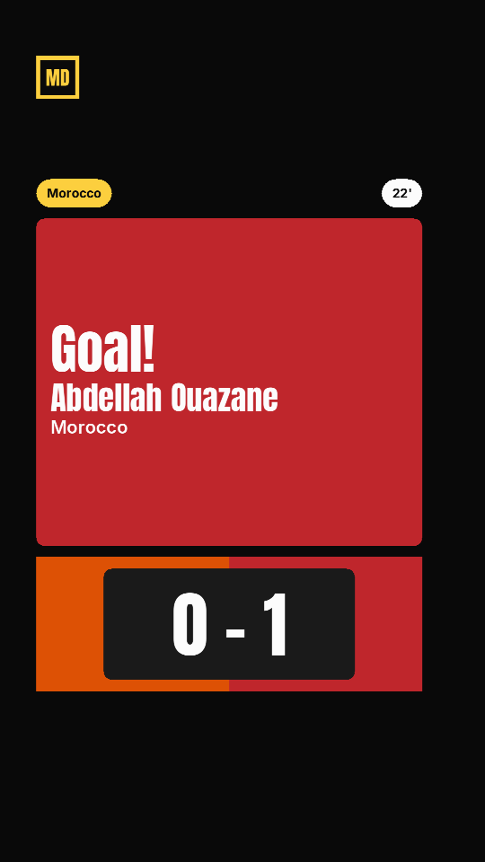 | Yellow flash, punch, counter | story |
| `red_card` — red chip + minute, the card, player, score as it stands | 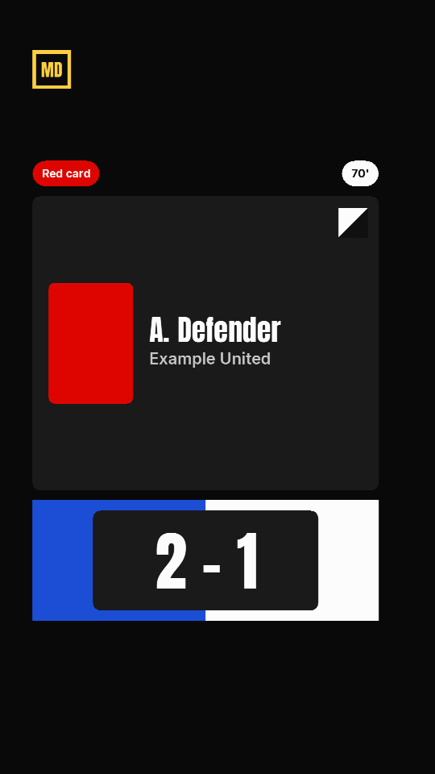 | Card grows, words rise | story |
| `stat_bars` — values left/right, label centred, bars split in the sides' colours | 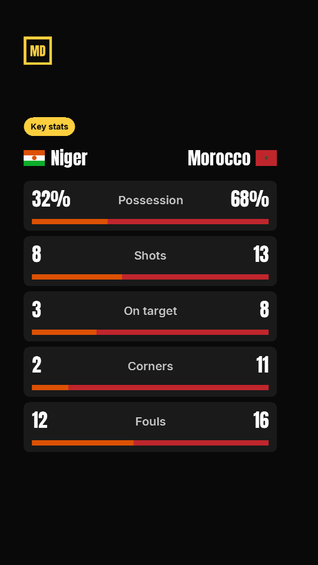 | Rows rise, bars grow from both ends | story |
| `mini_table` — rows around both sides, theirs in their colours | 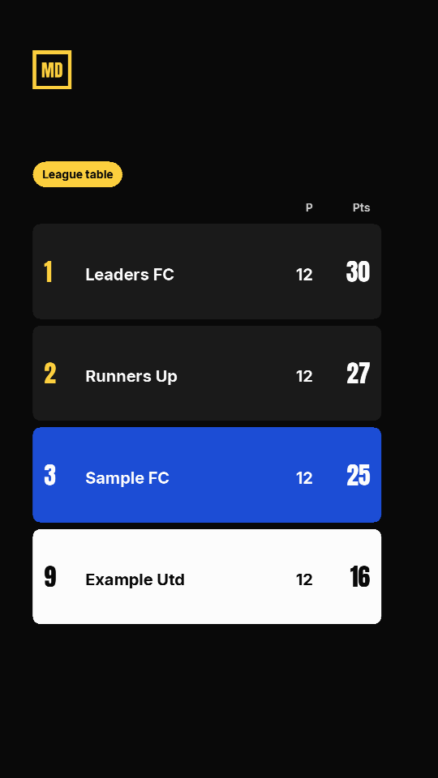 | Rows rise one by one | story, slideshow |
| `form_chips` — last five, oldest first: W yellow, D grey, L red | 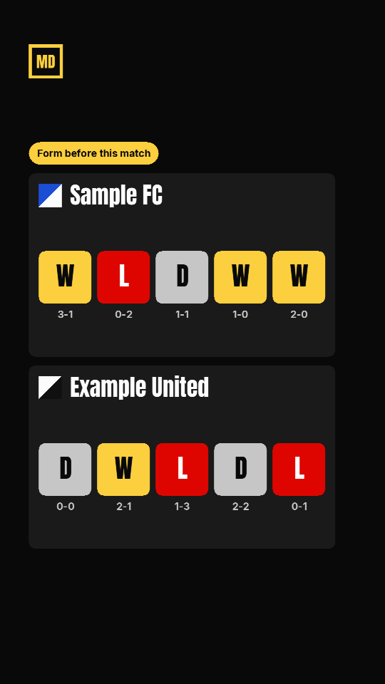 | Chips pop left to right | story, slideshow |
| `head_to_head` — wins / draws / wins counts, latest results | 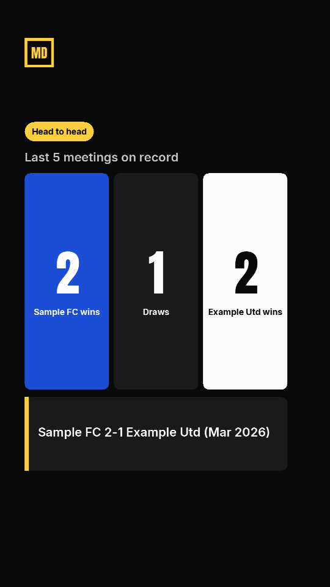 | Counts punch in | story |
| `profile` — photo area, name with flag, label, numbers, credit | 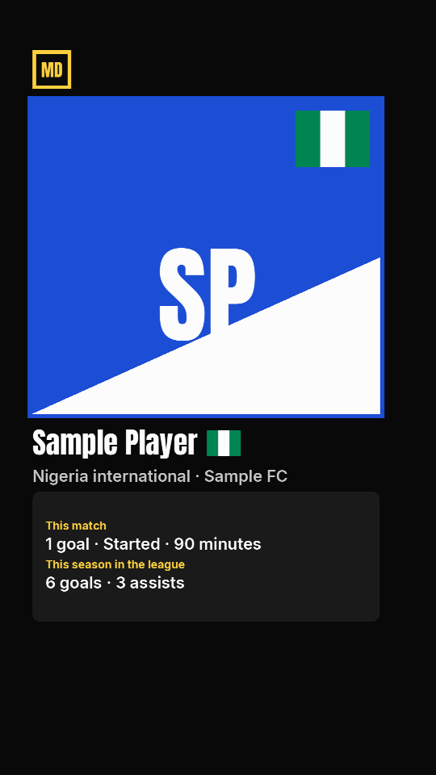 | Photo pushes in, words rise | story, slideshow (Team of the Week, milestones) |
| `roster` — several players with a line each | 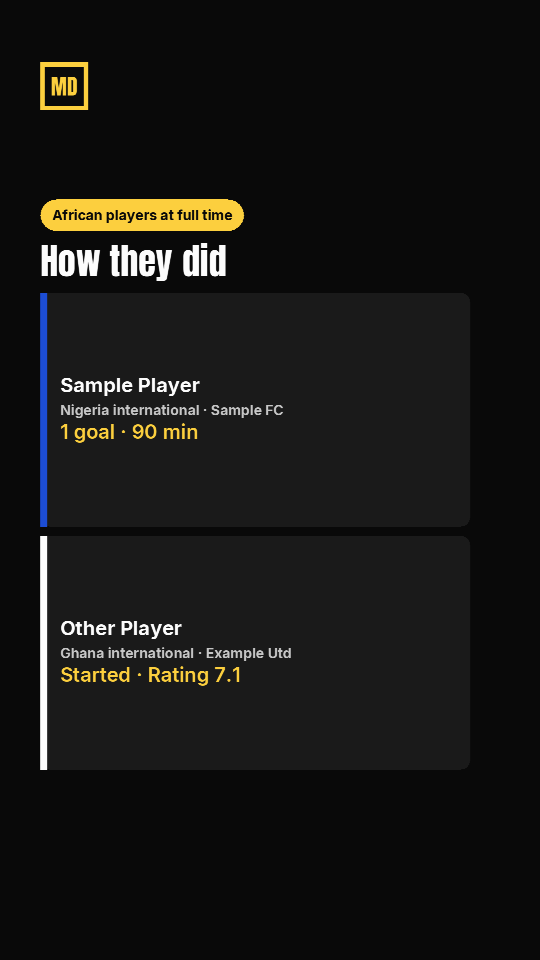 | Rows rise | slideshow |
| `fixtures` — next match for each side | 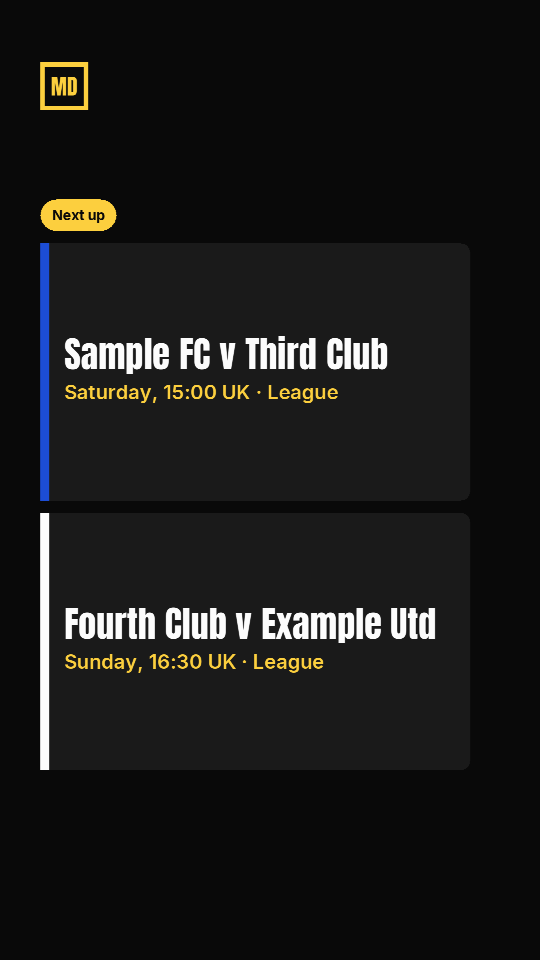 | Rows rise | story |
| `fact_list` — titled facts | 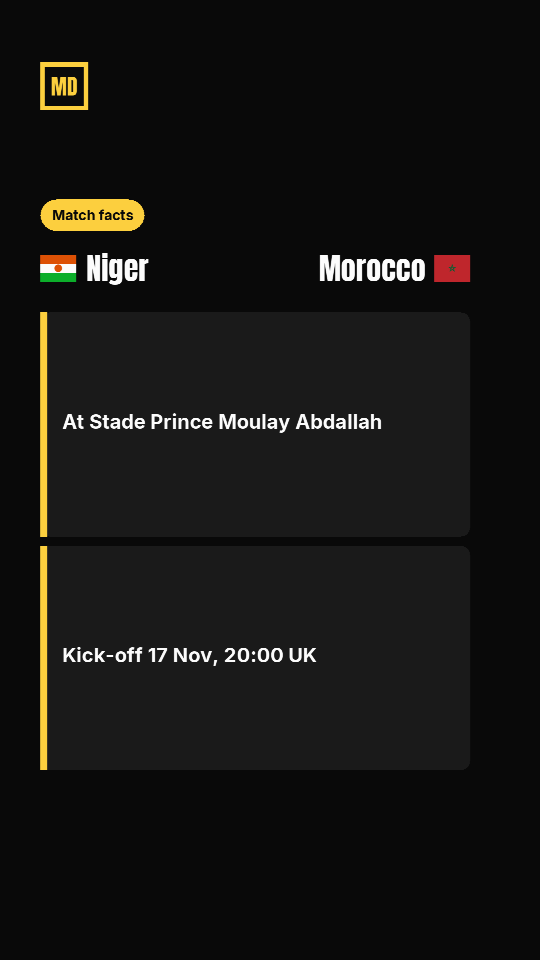 | Lines rise | story |
| `banter` — yellow card, black words one by one, the sides' colour bands | 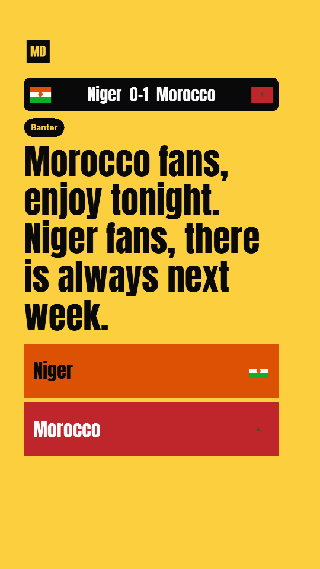 | Words rise | story |
| `closing` — question word by word, comment ask, follow ask, logo + matchday.africa | 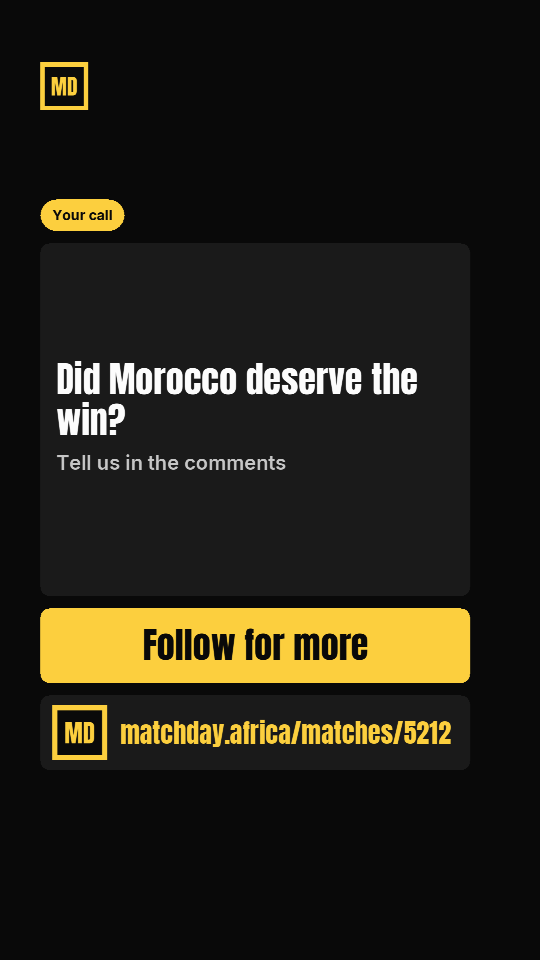 | Kinetic, follow ask punches in | story, slideshow |
| `radio_cover` — Matchday Radio chip and edition, the story's headline card (or photo/cover art), caption words as they are spoken | 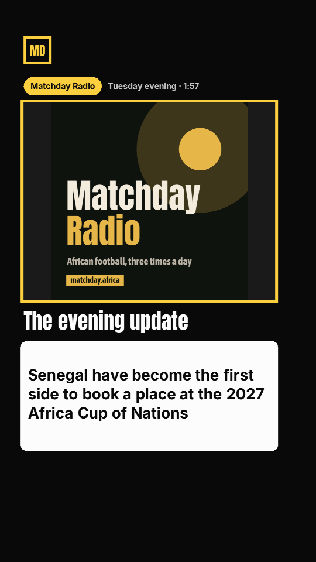 | Words appear with the voice | radio video (story `radio_video` and `radio:video`) |
| photo credit line | (on hook, profile, radio) | Present for the whole cut | all |

The reference images use `resources/design/samples.json`: the Niger v Morocco numbers are from match
5212; the "Sample FC v Example United" cards are made up to show layouts and are never published.

## 4. Motion

- **Every beat moves:** words rise one by one (kinetic text), scores punch in and tick, bars grow,
  chips pop, photos have Ken Burns (1.00 → 1.06, in on even cuts and out on odd ones, re-zoomed every
  3rd frame), and a **diagonal colour band** (the next card's accent with a yellow leading edge)
  wipes between cuts.
- **Timing:** the hook is visible from frame 0; cuts every 3–5 s (`motion.cut`, slideshows 4 s);
  transitions 0.35 s; entrances 0.35 s; word stagger 0.07 s, line 0.12 s, item 0.15 s.
- **One easing curve:** cubic Bézier `[0.2, 0.8, 0.2, 1]` (`motion.ease`), used by `Motion::ease` in
  PHP and `Easing.bezier` in the reel.
- **Music:** only `resources/audio/matchday_original_beat_v1.mp3` (the brief's
  `assets/music/…`; it lives in `resources/audio/` in this app), −14 LUFS, faded in 0.3 s and out
  2 s, ducked to 0.18 under any voice (`music.duck_under_voice`). Radio videos carry the edition's own
  audio and no extra music. Slideshows moved from the CC BY track to ours; older slideshows keep
  their recorded credit.

## 5. Content rules (enforced in code where possible)

| Rule | Enforcement |
|---|---|
| Images: licensed player photos with a credit, or our own renders. No crests, club logos, broadcast footage, agency or watermarked images | `Canvas::assertImage`: anything under `images.banned_dirs` (`public/war/warriors`, `public/generated/players`) fails; files outside `images.own_render_dirs` need a licence credit. Photos come only from `CommonsPhotos` (CC0/PD/CC BY/CC BY-SA). A card that shows a licensed photo must show its credit line (`Film::check`) |
| Facts only from our data | The planners (`StoryPlanner`, `SlideshowDeck`, `RadioVideo`) read the database only; missing facts drop the line or card |
| Banned copy: "quietly", "it's not X, it's Y", "most people…", emoji arrows, sirens, all-caps sentences | `CopyRules` (patterns in `tokens.copy`) on every on-screen text item and every phrase before it is split into words; a hit fails the render. `CopyRules::clean` strips arrows and sirens |
| Never repeat the same card within one video | `Film::assertNoRepeats` (component + content); the design check also compares frames from different cards on the pixels. Story padding uses distinct verified cards only, so a match with little data makes a shorter story (as long as its distinct cards allow, never over 75 s) rather than repeat one |

## 6. The design check

```
php artisan design:check --story=12            # a rendered match story or radio video
php artisan design:check --slideshow=7
php artisan design:check video.mp4 [--manifest=design.json] [--sheet=out.png] [--every=5]
```

It samples one frame every 5 s, draws a contact sheet (unsafe zones outlined; a failing frame gets a
red border and its problems underneath) and flags:

- text inside the unsafe zones;
- frames more than 35% empty (if a frame was sampled mid-entrance, the same card is measured again at rest);
- repeated cards (manifest keys, and near-identical frames from different cards);
- photos without their credit;
- fonts, sizes or colours that are not tokens (or the match's team colours), contrast pairs the rules forbid, banned copy.

Renderers save the layout record as `design.json` next to their work files
(`storage/app/stories/{id}/`, the slideshow work folder). A video without one still gets the pixel
checks (emptiness, near-identical frames). Exit code 1 when anything fails.

## 7. Renderers on the system

| Renderer | How it uses the design language |
|---|---|
| Match stories (`StoryFrames`, `StoryPlanner`, `StoryVideos`) | Beats mapped onto components, drawn by `Film`; manifest saved; music from tokens |
| Radio videos (`radio_video` stories and `radio:video`) | `RadioVideo::cuts` → `radio_cover` cuts through the same engine; one headline card per story |
| Slideshows (`SlideshowDeck`, `SlideshowRenderer`, `SlideshowVideo`) | Slides are component cuts; stills and the video come from `Film`; our own music |
| Reels (Remotion, `reel/src`) | Colours, fonts (Anton + Inter), easing and safe zone from `reel/src/design.js` (the same JSON); keeps its comic statue layout |
| Preview and social cards (`StoryCardRenderer`, `FixtureCardRenderer`, `BanterCardRenderer`, `ChallengeCardRenderer`) | Colours and fonts from tokens, sentence case; their 1200x675 / 1080x1080 layouts are their own |

### Not yet on the shared components

- The reels keep their own Remotion layout (army statues, comic framing); they read the tokens but do
  not use the GD components.
- The still cards read token colours and fonts, but their font sizes and layouts are still per card.
  Moving them onto `Scene`/`Components` for other canvas sizes is the next step.
